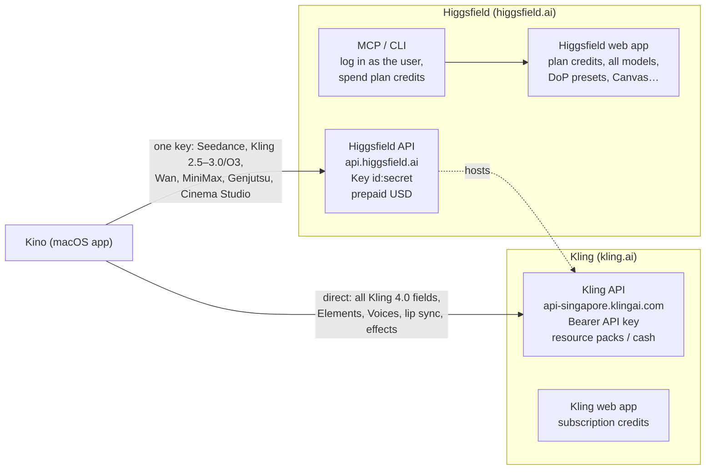
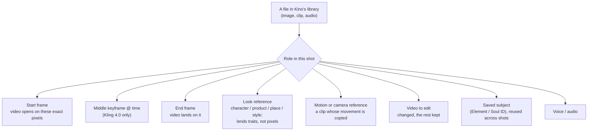
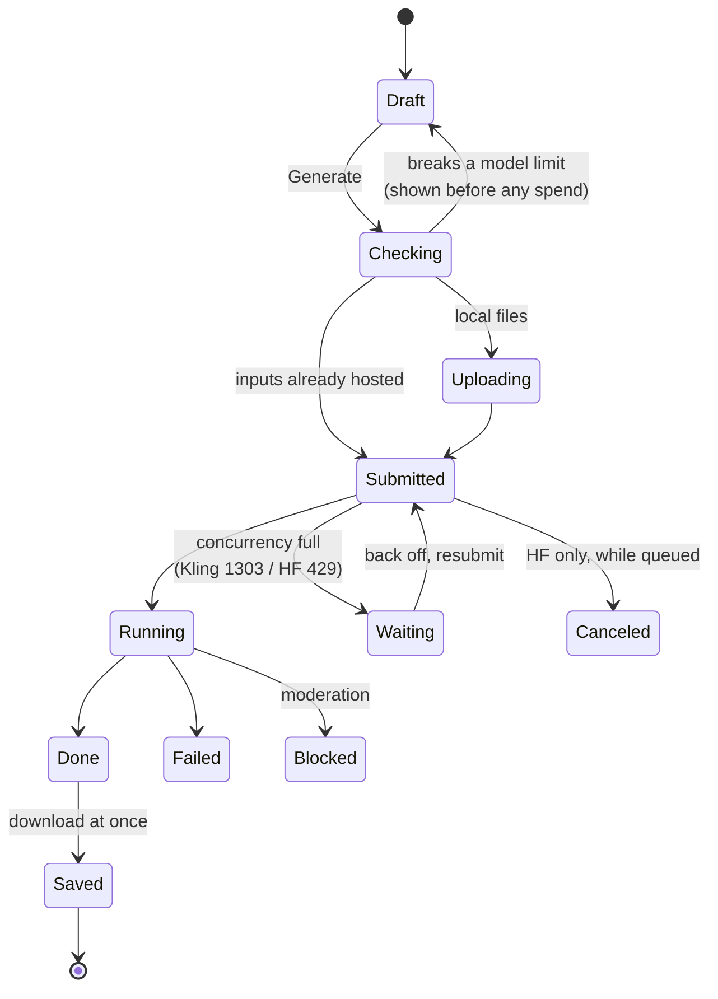

# Kino: how Kling and Higgsfield generate video (reference map)

As of **2026-11-04**, from each company's own docs. This page maps both systems onto **one model for Kino**: what a
file can *be* in a generation, how each service wants it named, which modes exist where, and how a job lives and dies.
The details, with a source after every fact, are in:

- [kling.md](kling.md): Kling's models, modes, input roles and limits, prompt structure, the API (both designs), pricing,
  web-app workflow, and the conflicts found.
- [higgsfield.md](higgsfield.md): Higgsfield's own models and the ones it hosts, tools (DoP presets, Cinema Studio,
  Elements, Popcorn, Canvas…), the API and its **field tables for all 84 endpoints** (Appendix A), MCP/CLI, workflow.

Both services change monthly (Kling 4.0 shipped 2026-10-15/28, Seedance 2.5 and Cinema Studio 4.0 since August).
Recheck a limit against the linked page before code depends on it. Marked **[inferred]** = our reading, not their docs.

---

## 1. The two systems at a glance



| | Kling API | Higgsfield API |
|---|---|---|
| What you get | Kling's own models only, newest first (4.0 with every field), plus Elements, Voices, lip sync, avatar, TTS, sound, 219 effect templates, try-on | ~30 video/image models from several makers under one key; Kling 2.5–3.0/O3/Omni + Motion Control (Kling 4.0 listed, **no field schema yet**) |
| Not there | upload endpoint, cost estimate, upscaling, extend for current models (4.0 "coming soon") | Veo, Sora 2, Nano Banana, Popcorn, **DoP camera presets**, lip sync, upscale, reframe, Elements creation |
| Billing | prepaid resource packs (4.0 needs a **Flagship** pack) or cash; separate from web credits [inferred] | prepaid USD, separate account from any web plan; `POST /estimate` before submitting |
| Kling 4.0 price | 1.0 / 1.5 units per s (≈ $0.157 / $0.235) at 720p / 1080p | "from" $0.094/s list, $0.066/s launch discount |

The **web apps** do more than either API (DoP's 419 named camera presets, Canvas, Kling Motion Library, upscalers),
and **Higgsfield's MCP** reaches the web lineup, but MCP logs in as the user and spends their plan credits; it is meant
for agents, not as an app's backend (Higgsfield's terms). Sources: [higgsfield.md §0, §5.7–5.8](higgsfield.md),
[kling.md §5.8](kling.md).

---

## 2. One model for inputs: a file has a role

Both services decide what a file *does* from the slot it is sent in, and then from how the prompt talks about it.
Kling: "If a material is referenced without an explicit purpose, the model will infer how to use it." So Kino should
give every attached file a **role** and a **handle**, and write the role into the prompt itself.



| Kino role | Kling API (new design, 4.0) | Kling legacy `/v1` | Higgsfield API (field names vary by model; Appendix A) |
|---|---|---|---|
| Start frame | `contents[] {type: first_frame}` | `image` | `image_url` (most), `first_frame_url` (Kling O3/Omni) |
| Middle keyframe | `{type: middle_frame}`, ≤10 frames in all, **timing written in the prompt** | – | – (Kling 4.0 web only so far) |
| End frame | `{type: last_frame}`; 3.x/2.x need a start frame too; 2.x forces 1080p | `image_tail` | `last_image_url` (Kling 3.0), `end_image_url` (Seedance, Wan, LTX, PixVerse, MiniMax), `last_frame_url` (O3/Omni); none on HappyHorse, Wan 2.6, Kling 3.0 Turbo |
| Look reference | `{type: refer_image}` ≤10 (4.0) | `image_list` | `image_urls`: Seedance 2.5 ≤30, Cinema Studio 4.0 ≤30, Wan 3.0 ≤10, MiniMax H3 ≤9, Grok ≤7, Kling O3 ≤4 |
| Motion / camera reference | `{type: feature_video}` ≤5 clips, ≤30 s total | `video_list` (refer) | `video_urls`: Seedance 2.5 ≤10, Wan 3.0 ≤5, MiniMax H3 ≤3; Kling O3 `video-reference` 1 |
| Character + performance clip | `/motion-control/kling-3.0`: `image` + `video`, `character_orientation` | – | `kling-video/v3/motion-control/*`: `image_url` + `video_url`; Genjutsu `motion-transfer` |
| Video to edit | `{type: base_video}` (1) | `video_list` (base) | `video_url` on `seedance-2.5/video-edit`, `kling-video/o3/video-edit`, Genjutsu `object-swap` / `restyle` |
| Saved subject | `{type: element, element_id}`; made by `POST /v1/general/advanced-custom-elements` (2–4 images or a 3–8 s clip) | `element_list` | Kling `elements` ids (no create call); Soul `custom_reference_id` (trained by `POST /v1/custom-references`); web Elements `@tag` |
| Voice / audio | `{type: voice, voice_id}` ≤3 (speech only: "background music or sound effects is not supported") | `voice_list` | `audio_urls` (Seedance ≤10, Wan 3.0 ≤5, MiniMax ≤3) or a single driving `audio_url` (Wan 2.6/2.7, Grok) |

Sources: [kling.md §2–3](kling.md), [higgsfield.md §3.2, Appendix A](higgsfield.md).

**Start frame vs reference** is the distinction users trip on: a frame is pixels on the timeline, a reference only lends
looks. Kling's tip: bind the subjects that appear in the start frame as Elements too, for consistency.

---

## 3. Naming files in the prompt (tagging)

Every surface has its own syntax. Kino keeps **one** syntax for the user (`@hero`, `@shoe`, `@walk`, chips in the
prompt field) and rewrites it per service when it builds the request [inferred].

| Where | Syntax | How the handle is assigned |
|---|---|---|
| Kling web (4.0 Omni Reference) | `@Image1`, `@Video1` | numbered in upload order |
| Kling web, Elements | `@Banana Cat` (type `@` to pick) | the element's name |
| **Kling API, new design** | `@image_1`, `@start`, `@hero`… | **any `id` you set** on the `contents[]` item; a voice with id `1` is `@1` |
| Kling API, legacy / multi-element edit / Omni Image | `<<<image_1>>>`, `<<<video_1>>>`, `<<<element_1>>>`, `<<<voice_1>>>` | position in each list |
| Higgsfield web, Elements | `@char_hero_v1` | the Element ID you set |
| **Higgsfield API, Cinema Studio 4.0** | `<<<image_1>>>`, `<<<video_1>>>`, `<<<audio_1>>>` | position in `image_urls` / `video_urls` / `audio_urls` |
| Higgsfield Seedance, Nano Banana, MCP | a sentence at the start: "The first image is the character, the video is the motion reference" | none: prose, by order |
| Higgsfield Popcorn | "image one", "image three" | order |
| Higgsfield Canvas, Kling node | an image wired in = **start frame**; characters must be Elements | – |

Kling's warnings for names: avoid handles that are substrings of each other (`@Ann` / `@Anna`) or that look like normal
words in the prompt (`@gmail`). Since Kling's new API takes any id, Kino's own handles can pass straight through there.

---

## 4. What can be made, and where

✓ = in the API. **web** = web app only. **soon** = announced, not live.

| Mode | Kling API | Higgsfield API |
|---|---|---|
| Text → video | ✓ every model (4.0: 3–30 s) | ✓ Seedance 2.5, Kling 2.5–3.0, Wan 3.0, MiniMax H3, LTX, PixVerse… |
| Start frame → video | ✓ every model | ✓ most models |
| Start + end frame | ✓ 4.0, 3.0, O1, 2.6, 2.5 Turbo (not 3.0 Turbo) | ✓ Kling 3.0/O3/Omni, Seedance, Wan 2.7/3.0, LTX, PixVerse, MiniMax |
| Several keyframes (≤10) | ✓ 4.0 only | web (Kling 4.0) |
| Reference images → video (consistent subject) | ✓ 4.0, 3.0 Omni, O1; 3.0 via ≤3 Elements | ✓ Seedance 2.5 (≤30), Cinema Studio 4.0, Wan 3.0, MiniMax H3, Kling O3 |
| Copy motion / camera from a clip | ✓ 4.0, 3.0 Omni, O1 (`feature_video`) | ✓ Seedance video refs, Kling O3 video-reference |
| Character performs a recorded motion | ✓ Motion Control 3.0 / 2.6 | ✓ Kling Motion Control, Genjutsu Motion Transfer |
| Edit a clip by instruction | ✓ 4.0, 3.0 Omni, O1 (write **"Edit @video"**, not "Reference") | ✓ Seedance 2.5 edit, Kling O3/Omni edit, Genjutsu swap / restyle |
| Mask-and-swap edit (click points) | ✓ multi-element editing (2–5 s or 7–10 s clips) | web (Seedance 2.5 region edit) |
| Extend a clip | legacy V1.x only; 4.0 to 2 min **soon** | ✓ Seedance 2.5 extension, Grok 1.5 |
| Several shots in one generation | ✓ 3.x `multi_shot` (≤6 shots, ≤512 chars each); 4.0 automatic, timecoded in the prompt | ✓ Kling `multi_prompt` (1–6 shots); Cinema Studio `pacing` |
| Named camera moves | prompt words (4.0 has no field; `camera_control` legacy V1.x only) | ✓ Cinema Studio 4.0 `camera_movement` (33), LTX `camera_movement` (8); **DoP's 419 presets: web** |
| Look controls (genre, era, lens, grade, light) | prompt words | ✓ Cinema Studio 4.0 enums (Appendix A) |
| Native sound / dialogue | ✓ 4.0 always on; 3.0 `audio: native`; 2.6 at 1080p | ✓ Seedance, Kling 3.0, Wan 3.0, MiniMax H3, Grok |
| Talking photo / lip sync | ✓ Avatar 2.0 (≤5 min), lip sync (2–60 s audio), TTS | web (Lipsync Studio, Speak, Intone) |
| Sound for a silent clip | ✓ video-to-audio, text-to-audio | – |
| Effect templates | ✓ 219 (`/v1/videos/effects`) | web (Effects / Viral Presets) |
| Upscale, reframe, outpaint | outpaint images only | web |

Sources: [kling.md §2.1, §5.2, §5.8](kling.md), [higgsfield.md §1.2, §2, §5.8](higgsfield.md).

---

## 5. A job's life



| Step | Kling | Higgsfield |
|---|---|---|
| Auth | `Authorization: Bearer <API key>` (legacy: AK/SK JWT) | `Authorization: Key <id>:<secret>` (not Bearer) |
| Local files | **no upload endpoint**: images as URL or Base64, **videos only as URL** | `POST /files/generate-upload-url` → `PUT` → `public_url` (1 h to upload, kept ≤7 days); JPEG/PNG/WebP/GIF, WAV, **MP4 only** |
| Cost before submit | none: price table, then `billing[]` on the task; `GET /account/costs` | `POST /estimate/{endpoint}` → `{"usd": …}` |
| Duplicate protection | `options.external_task_id` (unique per account; also used to query) | `Idempotency-Key` header (same key = same request, no new charge) |
| Statuses | `submitted` → `processing` → `succeeded` \| `failed` (legacy says `succeed`) | `queued` → `in_progress` → `completed` \| `failed` \| `nsfw` \| `canceled` |
| Watching | `GET /tasks?task_ids=a,b` (batch; queries cost no concurrency) | `GET /requests/{id}/status`, poll 2 s ×1.5 up to 10 s with jitter |
| Webhooks | Standard Webhooks, optional | Standard Webhooks, retried up to 2 h |
| Busy | `1303` over the pack's parallel-task limit; no QPS limit | queued above concurrency (2 / 10 / 20 / 40 by funds added); `429 account_queue_full` when the queue is full |
| Refused content | `1301` at submit, or `failed` with a message | `nsfw` (refunded) |
| Results | hotlink-protected URLs, **deleted after 30 days** | URLs expire **7 days** after finishing (`expires_at`) |
| Typical time | video 1–5 min | 30 s–10 min; heavy models 15–20 min |

For a desktop app with no public address, **poll; don't use webhooks** [inferred]. Kling's docs: once a task id is
returned, query it, never resubmit.

**Uploading for Kling** is the open problem: video inputs need a reachable URL and Kling hosts none. Options to weigh
when building [inferred]: a Higgsfield presigned upload (public, ≤7 days) used as Kling's input URL; storage the user
already has that gives a direct link; or only Kling outputs (by `video_id`, ≤30 days) as video inputs.

---

## 6. Writing the prompt

Kling 4.0's official structure and Higgsfield's cinematic guide agree; one template serves both [inferred]:

```
[Asset roles]    @hero is the character: keep face, hair and outfit. @kitchen is the place: keep its layout.
                 Follow the camera path and pacing of @walk; do not carry over its people or scene.
[Overall]        Scene and texture… Visual style… Camera tone…
[Timeline]       0–3 s: …   3–7 s: … (camera + action + emotion)   7 s–end: … (closing shot)
[Audio]          Who says what, in quotes, in the target language (age, tone, pace); ambience; music; effects.
[Exclusions]     no subtitles, no background music   (Kling adds both unless told not to)
```

- **Describe, don't judge**: "side backlight outlines the edges", not "premium feel". Positive phrasing; no negative
  prompt field on Kling's new API or most Higgsfield models. Only "no subtitles" / "no background music" are needed.
- **Image → video describes motion only**: the frame already shows the look; re-describing it fights the image.
- **Editing**: "Edit @clip. Change ___ to ___. Keep everything else unchanged." The word "Edit" decides the pipeline.
- **Keyframes**: for a start frame write what happens next; for an end frame the path into it; for a middle frame
  what happens there and how the camera arrives.
- **Duration and shape from the prompt**: Kling 4.0 reads "a 15-second video" when duration is left empty, and
  `adaptive` aspect follows the edit video, then the first frame.
- **Iterate one change at a time**; draft cheap (720p, Turbo, Seedance Draft Mode), then re-render the same prompt.
- **Storyboard sheets as references**: ask for finished frames, or grid lines and labels leak into the video.
- Prompt limits: Kling 4.0 ≈ 26,000 English chars (8k tokens); 3.x 3,072; 2.x 2,500; per shot 512. Higgsfield per
  model (Kling 2,500, LTX 5,000, Genjutsu 10,000). Higgsfield's CLI advice: about 200 tokens works best.

Sources: [kling.md §4](kling.md), [higgsfield.md §4](higgsfield.md).

---

## 7. What this suggests for Kino's screens and functions [inferred]

Not decisions; starting points for when the UI is designed.

| Kino part | What it holds | Why (from the maps above) |
|---|---|---|
| **Library** | your media, plus named **subjects** (character, product, place: a few images or a short clip) and voices | both services key consistency on saved subjects; Kling Elements and Voices are async objects with their own tasks |
| **Shot** | prompt with `@` chips; each attached file with its role; duration, aspect, resolution; service + model | §2–3: roles and handles are the whole input model |
| **Check before Generate** | the chosen model's limits (counts, sizes, lengths, aspect windows: 4.0 2:5–5:2, others 1:2.5–2.5:1; 15 refs / 5 clips / 30 s), and the cost | an invalid request is a 1201/422 after waiting; Higgsfield estimates exactly, Kling from its table |
| **Request builder** | Kino's roles and handles → Kling `contents[]` with ids, or Higgsfield's per-model fields and `<<<image_n>>>` or a role sentence; the "[Asset roles]" lines written from the roles | §3: one syntax for the user, many on the wire |
| **Queue** | jobs with Kino's states (§5), backoff on busy, idempotency keys, resume after relaunch | concurrency is per account and small (Higgsfield's pricing page: 2 for a new account) |
| **Results** | downloaded at once next to the project; "use as start frame", "use last frame for the next shot", "edit this", "make a subject from it" | URLs die (7 / 30 days); both web apps' best-loved feature is reusing outputs as inputs |
| **Brief** | Don's vibe and style fill the [Overall] block and default the look controls | AGENTS.md: Kino works to Don's brief |

Keys go in the Keychain, as Tala's ElevenLabs key does (AGENTS.md).

---

## 8. Open questions to settle before building

1. **Which accounts exist?** Both APIs bill separately from the web subscriptions (Kling: API resource packs, and
   4.0 needs a Flagship pack; Higgsfield: a separate API account with a USD balance). A web plan alone gives no API.
2. **Kling direct, Higgsfield, or both?** Direct gives Kling 4.0's full fields, Elements, Voices, lip sync; Higgsfield
   gives one key for Seedance/Wan/Kling, uploads, estimates, and a lower listed Kling 4.0 price, but no 4.0 schema yet.
3. **Hosting local clips for Kling** (§5).
4. Unresolved in the docs: Kling 4.0 web credit price; whether 4K is live for 4.0; Higgsfield concurrency (2 vs 20 for
   a new key); whether DoP exists on Higgsfield's API (treated as no); which Kling element syntax 3.x accepts (`@id`
   vs `@Name`). Full lists: [kling.md §8](kling.md), [higgsfield.md §8](higgsfield.md).
